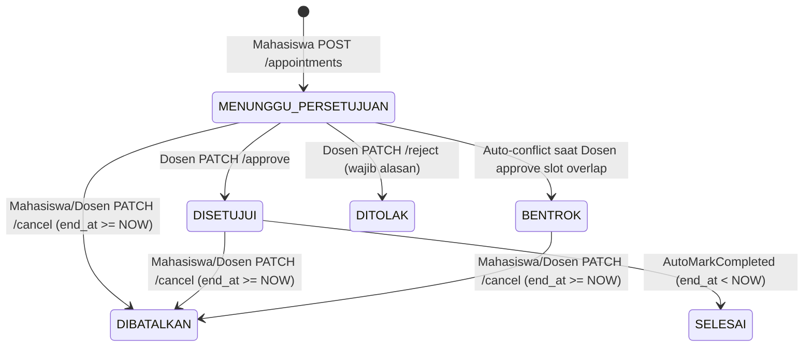

# 02 — Business Flow & State Transition Mapping

Dokumen ini memetakan seluruh alur bisnis aktual dari UI hingga Database (`UI → Validasi Frontend → API Request → Authorization → Business Logic → Database → Response → UI Update`) serta analisis lengkap **State Transitions** berdasarkan implementasi kode.

---

## 1. Pemetaan Alur Bisnis per Fitur (`VERIFIED`)

### Fitur 1: Autentikasi, Failover Healthcheck, & Token Rotation
- **Role**: Semua (`ADMIN`, `DOSEN`, `MAHASISWA`) | **Halaman**: `/auth/login`
- **Kondisi Awal**: User belum login; browser memanggil `GET /healthz` (timeout 4s).
- **Input**: `NIM / NIP` (atau email), `Kata Sandi SSO`.
- **Alur**:
  1. Login page mengecek `/healthz`. Jika gagal/DB down → form disabled & tampil modal `"Server Sedang Dalam Perbaikan"`.
  2. Submit → `POST /api/v1/auth/login` (rate-limit `1 req/s burst 5`).
  3. `AuthService.Login`: cari user by identifier/email → cek `is_active` → bandingkan bcrypt hash → buat JWT Access Token (15m) & Refresh Token (7d) → simpan hash refresh token ke `user_sessions`.
  4. Response set HttpOnly cookies + JSON user → redirect sesuai role (`/admin/dashboard`, `/lecturer/dashboard`, `/student/dashboard`).
- **Dampak DB**: Insert 1 baris di `user_sessions` + 1 baris di `audit_logs`.
- **Gagal**: Kredensial salah (`401`), akun nonaktif (`403`), melebihi rate-limit (`429`).

### Fitur 2: Manajemen Pengguna & Batch CSV (Admin)
- **Role**: `ADMIN` | **Halaman**: `/admin/users`
- **Input Create**: `identifier` (numeric ≥ 10 digit), `name`, `email` (`@telkomuniversity.ac.id` untuk DOSEN; `@student.telkomuniversity.ac.id` / `@telkomuniversity.ac.id` untuk MAHASISWA), `role` (`DOSEN` / `MAHASISWA`). Default password jika kosong: `password123`.
- **Proses**: Validasi frontend (`admin/users/page.tsx:119-156`) → `POST /api/v1/admin/users` → `adminGuard` → `AdminService.CreateUser` (cek duplikat NIM/NIP & email) → insert `users` + `audit_logs`.
- **Dampak Role Lain**: User baru langsung bisa login; jika dinonaktifkan (`is_active=false`), seluruh sesi di `user_sessions` langsung dicabut (`RevokeAllUserSessions`) sehingga user tidak bisa refresh token.

### Fitur 3: Pengaturan Aturan Janji Temu & Kalender Akademik (Admin)
- **Role**: `ADMIN` | **Halaman**: `/admin/system-settings`, `/admin/academic-calendar`
- **Aturan Validasi (`settings_service.go:28-60`)**:
  - `min_minutes > 0`, `max_minutes >= min_minutes`, `min_minutes <= default_minutes <= max_minutes`, `slot_interval_minutes > 0`, `buffer_minutes >= 0`, `min_lead_days >= 0`, `max_advance_days >= min_lead_days`.
- **Kalender Akademik (`calendar_service.go`)**: `title` wajib, `start_date`/`end_date` format `YYYY-MM-DD`, `end_date >= start_date`, frontend mengirim `is_holiday: true`.
- **Dampak Role Lain**: Perubahan `system_settings` dan `academic_calendar` langsung dibaca oleh `AvailabilityService` & `AppointmentService` saat Mahasiswa mengajukan booking.

### Fitur 4: Jadwal Mengajar & Jadwal Terblokir Dosen
- **Role**: `DOSEN` | **Halaman**: `/lecturer/teaching-schedules`
- **Input Kuliah**: `course_name`, `room`, `day_of_week` (`SENIN`–`MINGGU`), `start_time < end_time`, `effective_from <= effective_until`.
- **Input Blokir**: `start_at` & `end_at` (ISO 8601, frontend kirim `${date}T${time}:00Z`), `end_at > start_at`, `start_at >= hari ini (WIB)`, `reason` wajib. Backend menormalisasi ke wall-clock UTC (`schedule_service.go:268-269`).
- **Dampak Role Lain**: Muncul di kalender Mahasiswa (mode `Jadwal Dosen` via `GET /teaching-schedules/lecturer/:id/activities`) & Admin Dashboard; otomatis memblokir booking Mahasiswa pada rentang jam tersebut.

### Fitur 5: Pengajuan Janji Temu Mahasiswa (Booking Engine)
- **Role**: `MAHASISWA` | **Halaman**: `/student/dashboard`, `/student/appointments` (`BookingBottomSheet`)
- **Validasi Berjenjang (`appointment_service.go` + `availability_service.go`)**:
  1. `title` tidak kosong; `end_at > start_at`.
  2. Durasi memenuhi `min_minutes <= duration <= max_minutes` dari `system_settings`.
  3. `start_at > now (wall-clock WIB)` dan `start_at <= now + max_advance_days`.
  4. Dosen ada, `role = DOSEN`, `is_active = true`.
  5. Tanggal bukan hari libur di `academic_calendar` (`is_holiday = true`).
  6. Dalam rentang ketersediaan dosen (default `08:00 - 17:00 WIB` jika `lecturer_availabilities` kosong).
  7. Tidak bentrok dengan `teaching_schedules`, `lecturer_blocked_schedules`, atau `appointments` aktif (`DISETUJUI` / `MENUNGGU_PERSETUJUAN`) ± `buffer_minutes`.
- **Dampak DB (Transaksi Atomik)**: Insert `appointments` (`status = 'MENUNGGU_PERSETUJUAN'`), insert `notifications` untuk Dosen, insert `notification_outbox` (`APPOINTMENT_REQUESTED`) → diproses `OutboxWorker` setiap 2 detik → push SSE ke browser Dosen.

### Fitur 6: Persetujuan, Penolakan, Pembatalan, & Auto-Selesai Janji Temu
- **Approve (`DOSEN`)**: `PATCH /appointments/:id/approve` → Lock baris (`FOR UPDATE`) → cek owner & status `MENUNGGU_PERSETUJUAN` → set `DISETUJUI` (dijaga GIST exclusion `prevent_lecturer_double_booking`, error `23P01` → `409`) → seluruh appointment lain milik dosen yang overlap & masih `MENUNGGU_PERSETUJUAN` otomatis diubah menjadi `BENTROK` → insert `notifications` + `notification_outbox` untuk mahasiswa pemenang & seluruh mahasiswa yang terdampak `BENTROK`.
- **Reject (`DOSEN`)**: `PATCH /appointments/:id/reject` → `reason` wajib → hanya dari `MENUNGGU_PERSETUJUAN` → set `DITOLAK` + `rejection_reason` → notifikasi & outbox ke Mahasiswa.
- **Cancel (`MAHASISWA` / `DOSEN`)**: `PATCH /appointments/:id/cancel` → `reason` wajib → cek kepemilikan → dilarang jika status `SELESAI`, `DITOLAK`, `DIBATALKAN`, atau `end_at < NOW()` (dijaga di Go repo **dan** DB trigger `trg_prevent_cancellation`) → set `DIBATALKAN`, `cancelled_by`, `cancellation_reason` → kirim 2 notifikasi (1 ke pihak lawan, 1 konfirmasi ke pembatal) + 1 outbox ke pihak lawan.
- **Auto-Complete (Sistem)**: `AutoMarkCompletedAppointments` berjalan tiap 30 detik dan saat query list → `UPDATE appointments SET status = 'SELESAI' WHERE status = 'DISETUJUI' AND end_at < NOW()`.

### Fitur 7: Penjadwalan Ulang (Reschedule Request)
- **Role**: `MAHASISWA` & `DOSEN` | **Halaman**: `/student/appointments/[id]`
- **Create (`POST /appointments/:id/reschedule`)**: `reason` wajib, `proposed_end_at > proposed_start_at`, `proposed_start_at > NOW()`, hanya untuk status `MENUNGGU_PERSETUJUAN` atau `DISETUJUI`, maksimal 1 request `PENDING` per appointment.
- **Respond (`PATCH /reschedule-requests/:id/respond`)**: `action` = `ACCEPT` / `REJECT`; responder harus pihak lawan (`responderID != requested_by`, jika sama → `ErrSameUserResponse`). Jika `ACCEPT`, jadwal appointment diperbarui & cek konflik GIST.

### Fitur 8: Masukan Pengguna (Feedback) & Zero-Backend Direct Storage
- **Role**: `MAHASISWA`, `DOSEN`, `ADMIN` | **Halaman**: `/student/feedback`, `/lecturer/feedback`, `/admin/feedbacks`
- **Alur Upload & Submit**:
  1. User melampirkan gambar (auto-kompres WebP di browser via `compressImageToWebP`) atau video (MP4/WebM), maks 4 file.
  2. Saat klik `Kirim Masukan`: untuk setiap lampiran, frontend panggil `POST /api/v1/feedbacks/upload-intent` → dapat `upload_url` (`/storage/upload/YYYYMMDD-<uuid>.<ext>`) & `public_url` (`/storage/uploads/...`) → frontend kirim binary langsung via `PUT /storage/upload/...` ke Nginx (`client_max_body_size 25M`).
  3. Frontend panggil `POST /api/v1/feedbacks` dengan `title` (min 3 kar), `content` (HTML dari `LMSRichEditor`, min 5 kar), dan metadata `attachments`.
  4. Backend simpan atomik ke `feedbacks` (`status = 'MENUNGGU_REVIEW'`) + `feedback_attachments`.
- **Alur Evaluasi Admin**: Admin buka `/admin/feedbacks` → klik kartu → buka `AdminFeedbackDetailModal` → pilih status (`MENUNGGU_REVIEW`, `SEDANG_DITINJAU`, `SELESAI`, `DIARSIPKAN`) & isi `admin_notes` (textarea) → `PATCH /api/v1/admin/feedbacks/:id/status` → tersimpan & langsung terlihat di tab Riwayat Mahasiswa/Dosen.

---

## 2. State Transition Analysis (`VERIFIED`)

### 2.1 `appointment_status`

**Transisi Terlarang yang Diverifikasi di Kode**:
- `DISETUJUI` / `DITOLAK` / `DIBATALKAN` / `BENTROK` / `SELESAI` → `DISETUJUI` (Ditolak `ErrInvalidAppointmentStatus`).
- `DISETUJUI` / `DITOLAK` / `DIBATALKAN` / `BENTROK` / `SELESAI` → `DITOLAK` (Hanya dari `MENUNGGU_PERSETUJUAN`).
- `SELESAI` / `DITOLAK` / `DIBATALKAN` → `DIBATALKAN` (Ditolak `ErrCannotCancelAppointment` + trigger `trg_prevent_cancellation`).
- Sembarang status dengan `end_at < NOW()` → `DIBATALKAN` (Ditolak di repo **dan** DB trigger `trg_prevent_cancellation`).
- Reschedule dari status `DITOLAK`, `DIBATALKAN`, `BENTROK`, atau `SELESAI` → Ditolak `reschedule_service.go:79-81` (hanya boleh dari `MENUNGGU_PERSETUJUAN` atau `DISETUJUI`).

### 2.2 `reschedule_status`
- `PENDING` → `ACCEPTED` (oleh pihak lawan)
- `PENDING` → `REJECTED` (oleh pihak lawan)
- **Terlarang**: Merespon request milik sendiri (`ErrSameUserResponse`); merespon status `ACCEPTED`/`REJECTED` (`ErrInvalidRescheduleStatus`); membuat request baru saat masih ada `PENDING` (`ErrPendingRescheduleExists`).

### 2.3 `feedback_status`
- Status valid: `MENUNGGU_REVIEW` (default saat dibuat), `SEDANG_DITINJAU`, `SELESAI`, `DIARSIPKAN`.
- **Catatan Aktual**: Admin dapat mengubah status feedback dari status valid mana pun ke status valid lainnya tanpa pembatasan transisi searah (`feedback_service.go:98-116`). Status di luar 4 enum ditolak (`400 INVALID_STATUS`).
