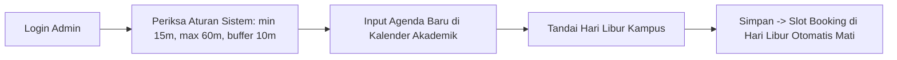
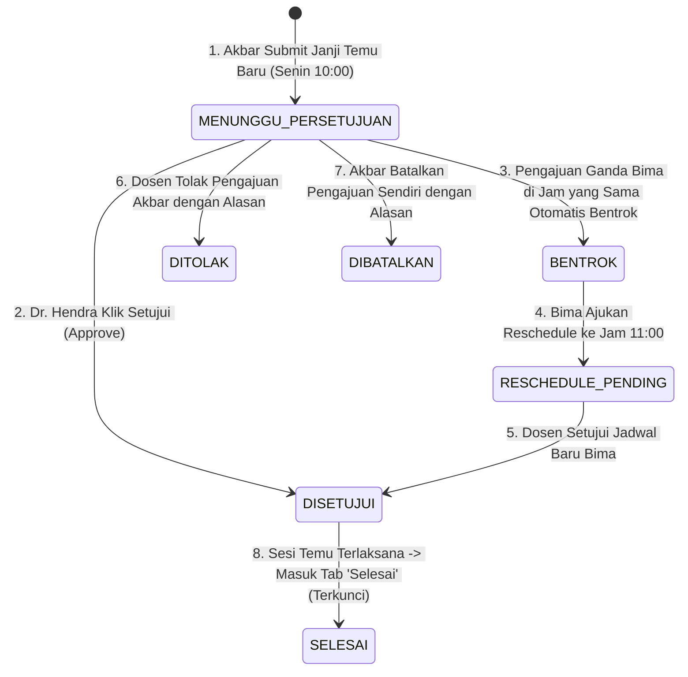

# BUKU PANDUAN PENGUJIAN UAT, UI/UX, & DATA UJI TRANSAKSI MENUJU PRODUCTION

**Sistem Informasi Terpadu Reservasi Dosen & Bimbingan Akademik (SITU-Reservasi)**  
_Lingkungan Pengujian: VPS Staging / Live Server (`https://38-9-47-207.sslip.io`)_  
_Dokumen Versi: 2.0 — Dual-Tester Edition (Lengkap dengan Evaluasi UI/UX & Bug Tracking)_

---

## DAFTAR ISI

1. [BAB 1: Master Kredensial Pengguna & Profil Tim Penguji (2 Tester)](#bab-1-master-kredensial-pengguna--profil-tim-penguji-2-tester)
2. [BAB 2: TAHAP 1 — Input Data Master oleh Admin (UI-Driven)](#bab-2-tahap-1--input-data-master-oleh-admin-ui-driven)
3. [BAB 3: TAHAP 2 — Input Jadwal Mengajar & Blokir oleh Dosen](#bab-3-tahap-2--input-jadwal-mengajar--blokir-oleh-dosen)
4. [BAB 4: TAHAP 3 — Eksekusi Transaksi Mahasiswa & Siklus Lengkap 7 Status](#bab-4-tahap-3--eksekusi-transaksi-mahasiswa--siklus-lengkap-7-status)
5. [BAB 5: Skenario Pengujian Kualitas Antarmuka & Pengalaman Pengguna (UI/UX Testing)](#bab-5-skenario-pengujian-kualitas-antarmuka--pengalaman-pengguna-uiux-testing)
6. [BAB 6: Format & Ruang Pelaporan Kendala / Pesan Error (_Bug Reporting Space_)](#bab-6-format--ruang-pelaporan-kendala--pesan-error-bug-reporting-space)
7. [BAB 7: Lembar Kerja Checklist UAT & Keputusan Produksi (_Go/No-Go Decision Matrix_)](#bab-7-lembar-kerja-checklist-uat--keputusan-produksi-gono-go-decision-matrix)

---

## BAB 1: MASTER KREDENSIAL PENGGUNA & PROFIL TIM PENGUJI (2 TESTER)

### 1.1 Identitas Tim Penguji (Dual-Tester)

Pengujian UAT dan evaluasi UI/UX ini dirancang untuk dijalankan secara kolaboratif oleh 2 orang penguji:

- **Penguji 1 (Tester 1)**: **wong 1** _(Lead QA / Mahasiswa Pemohon Utama)_
- **Penguji 2 (Tester 2)**: **wong 2** _(Secondary QA / Mahasiswa Pembanding & Uji Bentrok)_

Setiap butir pengujian memiliki kolom pencatatan **Tested By** agar pembagian tugas dan penanggung jawab pengujian tercatat secara transparan.

---

### 1.2 Master Kredensial Login di Server VPS Staging

- **Portal Akses Live**: `https://38-9-47-207.sslip.io/auth/login`
- **Default Password Semua Akun**: `password123` _(atau alternatif demo `Telkom2026!` jika mode mock aktif)_

| Peran           | Nama Pengguna                         | NIM / NIP (Identifier) | Email Resmi                                    | Catatan Peran Pengujian                          |
| --------------- | ------------------------------------- | ---------------------- | ---------------------------------------------- | ------------------------------------------------ |
| **Admin**       | Admin Prodi Informatika               | `198001012005011001`   | `admin@telkomuniversity.ac.id`                 | Setup aturan sistem & kalender akademik libur    |
| **Dosen 1**     | Dr. Eng. Hendra Kurniawan, S.T., M.T. | `198503152010121002`   | `hendra.kurniawan@telkomuniversity.ac.id`      | Review, Approve, Reject, Kuliah Senin            |
| **Dosen 2**     | Dr. Siti Aminah, S.Kom., M.Cs.        | `198807202014042001`   | `siti.aminah@telkomuniversity.ac.id`           | Uji bentrok kuliah Selasa (09:30–12:30 WIB)      |
| **Dosen 3**     | Prof. Ir. Budi Raharjo, Ph.D.         | `197911122003121003`   | `budi.raharjo@telkomuniversity.ac.id`          | Uji ketersediaan Rabu (10:00 WIB)                |
| **Mahasiswa 1** | Akbar Muhammad Sadat                  | `1203220154`           | `akbar.sadat@student.telkomuniversity.ac.id`   | Tester 1 (Transaksi 1, Cancel, Selesai)          |
| **Mahasiswa 2** | Bima Pratama Putra                    | `1203220012`           | `bima.putra@student.telkomuniversity.ac.id`    | Tester 2 (Uji Transparansi, Bentrok, Reschedule) |
| **Mahasiswa 3** | Citra Dewi Lestari                    | `1203220088`           | `citra.lestari@student.telkomuniversity.ac.id` | Penguji cadangan / verifikasi multi-user         |

---

### 1.3 Standar Penamaan Data Transaksi Baru

Agar pengujian mandiri dan tidak bercampur dengan data seeder lama, seluruh entitas baru yang dibuat wajib menggunakan prefix tag:
`[UAT-2026]`  
_(Contoh Topik: `[UAT-2026] Bimbingan Skripsi Bab 1`, Mata Kuliah: `[UAT-2026] Kecerdasan Buatan Lanjut`)_.

---

## BAB 2: TAHAP 1 — INPUT DATA MASTER OLEH ADMIN (UI-DRIVEN)

_Tujuan: Memasukkan data aturan reservasi baru dan menetapkan hari libur baru pada kalender akademik langsung melalui menu Admin._



### 2.1 Prosedur Uji Tahap 1

1. **Langkah 1.1**: Buka browser dan login sebagai **Admin Prodi Informatika** (`198001012005011001` / `password123`).
2. **Langkah 1.2 (Pengaturan Aturan Sistem)**:
    - Buka menu **Pengaturan Sistem** (`/admin/system-settings`).
    - Pastikan aturan durasi: Minimum 15 menit, Default 30 menit, Maksimum 60 menit, Jeda antar sesi (buffer): 10 menit, Maksimal pemesanan H+30 hari.
    - Simpan pengaturan jika ada penyesuaian.
3. **Langkah 1.3 (Input Hari Libur Kalender Akademik Baru)**:
    - Buka menu **Kalender Akademik** (`/admin/academic-calendar`).
    - Klik tombol **+ Tambah Agenda Kalender**.
    - Masukkan formulir data baru:
        - **Judul Agenda**: `[UAT-2026] Hari Libur Simulasi UAT Telkom University`
        - **Tipe Kegiatan**: `LIBUR_KAMPUS`
        - **Tanggal Mulai & Selesai**: Pilih hari **Jumat pekan depan**.
        - **Deskripsi**: `Libur simulasi pengujian akhir kesiapan sistem reservasi`.
        - **Checklist**: Centang **Tandai sebagai Hari Libur**.
    - Klik **Simpan Agenda**.
4. **Hasil yang Diharapkan**:
    - Agenda libur baru berhasil tersimpan dan tampil di tabel kalender akademik admin.
    - Pada sisi mahasiswa, hari Jumat tersebut otomatis ditandai sebagai hari libur dan sistem melarang pemilihan slot di hari tersebut.

---

## BAB 3: TAHAP 2 — INPUT JADWAL MENGAJAR & BLOKIR OLEH DOSEN

_Tujuan: Dosen memasukkan jadwal mengajar rutin perkuliahan dan jadwal agenda terblokir (rapat/dinas) baru melalui antarmuka dosen._

### 3.1 Prosedur Uji Tahap 2

1. **Langkah 2.1**: Logout dari Admin, lalu login sebagai **Dr. Eng. Hendra Kurniawan** (`198503152010121002` / `password123`).
2. **Langkah 2.2 (Input Jadwal Mengajar Rutin Baru)**:
    - Buka menu **Jadwal Mengajar** (`/lecturer/teaching-schedules`).
    - Klik **+ Tambah Jadwal Mengajar**.
    - Masukkan data baru:
        - **Mata Kuliah**: `[UAT-2026] Arsitektur Komputasi Awan (IF-44-01)`
        - **Hari**: `SENIN`
        - **Jam Mulai - Selesai**: `13:00 - 15:30 WIB`
        - **Ruangan**: `Ruang IF-204 (Gedung Selaru Lt. 2)`
        - **SKS**: `3`
    - Klik **Simpan**.
3. **Langkah 2.3 (Input Jadwal Terblokir / Cuti / Rapat Dosen)**:
    - Buka tab **Jadwal Terblokir** atau menu pengaturan blokir agenda.
    - Klik **+ Tambah Agenda Blokir**.
    - Masukkan data baru:
        - **Tanggal**: Hari **Kamis pekan depan**
        - **Waktu**: `09:00 - 12:00 WIB`
        - **Alasan Pemblokiran**: `[UAT-2026] Rapat Senat Kurikulum & Asesmen Akreditasi Internasional`
    - Klik **Simpan Agenda Terblokir**.
4. **Hasil yang Diharapkan**:
    - Di kalender dosen, jam 13:00–15:30 Senin tampil balok ungu **Jadwal Mengajar Kuliah**, dan jam 09:00–12:00 Kamis tampil balok abu-abu **Jadwal Terblokir**.
    - Keduanya tidak hilang dan tidak tertimpa saat ada janji temu bimbingan mahasiswa.

---

## BAB 4: TAHAP 3 — EKSEKUSI TRANSAKSI MAHASISWA & SIKLUS LENGKAP 7 STATUS

_Tujuan: Menjalankan transaksi nyata dari antarmuka mahasiswa dan dosen yang secara berurutan mencakup seluruh 7 status siklus hidup janji temu._



---

### Skenario 3.1: Status `MENUNGGU_PERSETUJUAN` (Pengajuan Baru Akbar)

- **Aktor**: Akbar Muhammad Sadat (`1203220154`) — _Tested by: Tester 1_
- **Langkah**:
    1. Login sebagai Akbar -> Buka menu **Agenda & Kalender**.
    2. Klik **+ Buat Janji Temu**.
    3. Pilih Dosen: **Dr. Eng. Hendra Kurniawan, S.T., M.T.**.
    4. Pilih Tanggal: Hari **Senin pekan depan**.
    5. Pilih Jam Kustom: `10:00 - 10:30 WIB`.
    6. Isi Topik: `[UAT-2026] Bimbingan Skripsi Bab 1 dan Studi Literatur`, Lokasi: `Ruang IF-204`.
    7. Klik **Kirim Pengajuan**.
- **Hasil yang Diharapkan**:
    - Toast hijau sukses muncul.
    - Janji temu tercatat di menu **Janjian Saya** pada tab **Menunggu** dengan status warna kuning amber (_Menunggu Persetujuan_).

---

### Skenario 3.2: Transparansi POV Bima & Status `BENTROK` (Pencegahan Rebutan Slot)

- **Aktor**: Bima Pratama Putra (`1203220012`) — _Tested by: Tester 2_
- **Langkah**:
    1. Login sebagai Bima di jendela browser terpisah / mode incognito.
    2. Buka menu **Agenda & Kalender** -> Beralih ke tab **Jadwal Dosen** -> Pilih **Dr. Eng. Hendra Kurniawan**.
    3. Perhatikan hari **Senin** jam `10:00 - 10:30 WIB`.
    4. Klik slot jam 10:00 atau buka modal booking untuk Dr. Hendra pada hari Senin tersebut.
    5. Perhatikan banner informasi di atas pemilih jam, lalu coba masukkan jam `10:00 - 10:30 WIB` dan kirimkan pengajuan topik `[UAT-2026] Konsultasi Magang Industri Bima`.
- **Hasil yang Diharapkan**:
    - Di kalender dosen pada layar Bima, terlihat balok bertuliskan **Bimbingan Skripsi Bab 1** atas nama **Akbar Muhammad Sadat (1203220154)** dengan badge kuning **Menunggu**.
    - Modal booking menampilkan banner biru:  
      `"Janji Temu Mahasiswa Lain pada Hari Ini: Akbar Muhammad Sadat (1203220154) (10:00 - 10:30 WIB) [Menunggu]..."`.
    - Jika Bima memaksa submit di jam 10:00, backend langsung menolak dengan pesan bentrok informatif:  
      `"Slot waktu telah diajukan terlebih dahulu oleh mahasiswa lain (Akbar Muhammad Sadat pada pukul 10:00 - 10:30 WIB) dan sedang menunggu persetujuan dosen"`.
    - _(Catatan Pengujian Auto-Bentrok)_: Jika pengajuan Bima masuk sesaat bersamaan sebelum dosen meninjau, ketika dosen menyetujui Akbar, status Bima otomatis berubah menjadi **BENTROK** (oranye).

---

### Skenario 3.3: Status `RESCHEDULE_PENDING` (Pengajuan Perubahan Waktu oleh Bima)

- **Aktor**: Bima Pratama Putra (`1203220012`) — _Tested by: Tester 2_
- **Langkah**:
    1. Buka pengajuan Bima yang berstatus **BENTROK** di menu _Janjian Saya_.
    2. Klik tombol **Ajukan Reschedule**.
    3. Pilih slot waktu alternatif yang benar-benar luang: jam `11:00 - 11:30 WIB`.
    4. Masukkan alasan perubahan jadwal: `[UAT-2026] Menggeser jam karena slot 10.00 telah diisi oleh rekan Akbar`.
    5. Klik **Kirim Reschedule**.
- **Hasil yang Diharapkan**:
    - Pengajuan reschedule berhasil terkirim.
    - Kartu menampilkan badge permohonan reschedule aktif.
    - Dosen menerima notifikasi bahwa Bima mengajukan pemindahan jam bimbingan.

---

### Skenario 3.4: Status `DISETUJUI` (Persetujuan Dosen untuk Akbar & Bima)

- **Aktor**: Dr. Eng. Hendra Kurniawan (`198503152010121002`) — _Tested by: Tester 1 & 2_
- **Langkah**:
    1. Login sebagai Dr. Hendra -> Buka dashboard dosen.
    2. Klik tombol hijau **Setujui** pada pengajuan Akbar (Senin jam 10:00 - 10:30 WIB).
    3. Klik tombol setujui pada pengajuan reschedule Bima (Senin jam 11:00 - 11:30 WIB).
    4. Buka menu **Agenda & Kalender Dosen** pada hari Senin.
- **Hasil yang Diharapkan**:
    - Kedua janji temu berubah status menjadi **Disetujui** (hijau emerald).
    - Pada kalender Dr. Hendra, jam 10:00–10:30 tertulis Akbar (Disetujui), jam 11:00–11:30 tertulis Bima (Disetujui), dan jam 13:00–15:30 kuliah Arsitektur Awan tetap utuh berdampingan rapi.
    - Akbar dan Bima mendapatkan notifikasi persetujuan di akun masing-masing.

---

### Skenario 3.5: Status `DITOLAK` (Penolakan Bimbingan dengan Alasan Edukatif)

- **Aktor**: Akbar Muhammad Sadat & Dr. Hendra — _Tested by: Tester 1_
- **Langkah**:
    1. Akbar mengajukan janji temu baru pada hari Selasa jam 14:00 - 14:30 WIB dengan topik `[UAT-2026] Konsultasi Tambahan Bab 2`.
    2. Dr. Hendra login -> Buka daftar permohonan masuk -> Klik tombol merah **Tolak**.
    3. Masukkan alasan penolakan: `[UAT-2026] Mohon selesaikan dahulu revisi Bab 1 sebelum mengajukan bimbingan Bab 2`.
    4. Konfirmasi penolakan.
    5. Akbar login kembali -> Buka menu _Janjian Saya_ -> Tab **Ditolak**.
- **Hasil yang Diharapkan**:
    - Status pengajuan berubah menjadi **Ditolak** (merah rose).
    - Akbar menerima notifikasi penolakan.
    - Kartu janji temu pada tab Ditolak menampilkan alasan dosen secara persis:  
      _""[UAT-2026] Mohon selesaikan dahulu revisi Bab 1 sebelum mengajukan bimbingan Bab 2""_.

---

### Skenario 3.6: Status `DIBATALKAN` (Pembatalan Mandiri oleh Mahasiswa)

- **Aktor**: Akbar Muhammad Sadat (`1203220154`) — _Tested by: Tester 1_
- **Langkah**:
    1. Akbar mengajukan satu sesi temu baru pada hari Rabu jam 09:00 - 09:30 WIB dengan Dr. Hendra topik `[UAT-2026] Sesi Diskusi Tambahan`.
    2. Buka detail janji temu tersebut di menu _Janjian Saya_.
    3. Klik tombol merah **Batalkan Janji Temu**.
    4. Masukkan alasan: `[UAT-2026] Mendadak ada jadwal ujian responsi praktikum`.
    5. Konfirmasi pembatalan.
    6. Periksa tab **Dibatalkan** dan menu **Pusat Notifikasi**.
- **Hasil yang Diharapkan**:
    - Muncul notifikasi resmi di akun Akbar:  
      `"Anda telah membatalkan janji temu '[UAT-2026] Sesi Diskusi Tambahan' dengan dosen Dr. Eng. Hendra Kurniawan... Alasan: [UAT-2026] Mendadak ada jadwal ujian responsi praktikum"`.
    - Pada tab **Dibatalkan**, kartu memuat penanda:  
      **Dibatalkan oleh Anda (Mahasiswa)** beserta alasan pembatalannya.

---

### Skenario 3.7: Status `SELESAI` (Verifikasi Tab Selesai / Riwayat Terkunci)

- **Aktor**: Akbar Muhammad Sadat (`1203220154`) — _Tested by: Tester 1_
- **Langkah**:
    1. Buka menu **Janji Temu Saya** (`/student/appointments`).
    2. Klik tab **Selesai**.
    3. Cari pertemuan masa lampau yang telah lewat dari jam selesainya.
- **Hasil yang Diharapkan**:
    - Pertemuan yang telah lewat otomatis bertransisi status menjadi **SELESAI** (_Sudah Selesai_, warna biru langit).
    - Kartu menampilkan badge _Pertemuan telah terlaksana (Riwayat Terkunci)_.
    - Tidak ada tombol aksi yang dapat mengubah data sesi yang sudah selesai (data arsip terkunci aman).

---

## BAB 5: SKENARIO PENGUJIAN KUALITAS ANTARMUKA & PENGALAMAN PENGGUNA (UI/UX TESTING)

Pengujian kualitas visual dan interaksi (_Design & Ergonomics Review_) wajib diverifikasi oleh kedua tester:

| No        | Komponen UI/UX                               | Aspek yang Diuji                                                    | Kriteria Kelayakan (_Expected UI/UX_)                                                                                                                             |
| --------- | -------------------------------------------- | ------------------------------------------------------------------- | ----------------------------------------------------------------------------------------------------------------------------------------------------------------- |
| **UX-01** | **Responsivitas Perangkat Mobile & Desktop** | Tampilan di layar HP (lebar 375px–414px) vs Laptop (1366px–1920px). | Layout tidak ada yang terpotong horizontal (no horizontal scrollbar), bottom-nav di HP rapi, sidebar di desktop kokoh.                                            |
| **UX-02** | **Keterbacaan Tipografi & Kontras Warna**    | Hirarki judul, badge status, dan teks muted.                        | Teks judul kontras tajam (slate-900), badge status memiliki kontras warna jelas (Hijau Disetujui, Kuning Menunggu, Oranye Bentrok, Merah Ditolak, Abu Terblokir). |
| **UX-03** | **Interaksi Bottom Sheet & Modal Dialog**    | Pembukaan modal booking dan konfirmasi batal/approve.               | Animasi slide-up halus, backdrop blur gelap di belakang modal, tombol tutup (X) dan klik luar modal menutup dengan mulus.                                         |
| **UX-04** | **Feedback Toast Notification**              | Notifikasi mengambang saat aksi berhasil atau gagal.                | Toast muncul di pojok kanan atas dengan ikon relevan (sukses/warning/error), otomatis hilang setelah 4 detik, dan tidak menumpuk berantakan.                      |
| **UX-05** | **Empty State & Loading Indicator**          | Tampilan saat data kosong atau sedang mengambil data API.           | Saat loading muncul spinner halus (`animate-spin`), saat data kosong muncul ilustrasi/ikon filter abu-abu dengan pesan yang informatif.                           |
| **UX-06** | **Penyatuan Menu & Navigasi Bersih**         | Tidak ada lagi menu ganda "Riwayat" di sidebar mahasiswa.           | Navigasi sidebar bersih (3 menu: Kalender, Janjian Saya, Notifikasi). Tab _Selesai_ menyatu mulus di dalam Janjian Saya.                                          |

---

## BAB 6: FORMAT & RUANG PELAPORAN KENDALA / PESAN ERROR (_BUG REPORTING SPACE_)

Jika dalam pelaksanaan pengujian terdapat skenario yang menghasilkan **FAIL**, penguji wajib mencatat kendala pada template berikut:

### Format Template Laporan Bug (Issue Tracking):

```markdown
### [BUG-ID]: [Judul Kendala / Error Singkat]

- **ID Kasus Uji Terkait**: (Contoh: TC-MHS-03 / TC-CROSS-02)
- **Tested By**: (Akbar Sadat / Bima Pratama)
- **Waktu Temuan**: (DD/MM/YYYY HH:mm WIB)
- **Peran Pengguna**: (Mahasiswa / Dosen / Admin)
- **Langkah Menuju Error (Steps to Reproduce)**:
    1. ...
    2. ...
- **Pesan Error / Tangkapan Layar (Error Log / Toast Message)**:
  `[Masukkan teks pesan error atau response code di sini, misal: 409 Conflict - SLOT_NOT_AVAILABLE]`
- **Hasil Aktual**: (Apa yang sebenarnya terjadi di layar)
- **Hasil yang Diharapkan**: (Apa yang seharusnya terjadi)
- **Saran Perbaikan / Catatan Tindak Lanjut Developer**: (Solusi kode yang diusulkan)
- **Status Tiket**: [ ] OPEN / [ ] IN INVESTIGATION / [ ] RESOLVED
```

---

### Ruang Pencatatan Bug Nyata Penguji (Silakan Isi Saat Menemukan Error):

#### Template Entri Bug 1:

- **ID Kasus Uji**: \***\*\*\*\*\***\_\_\_\***\*\*\*\*\***
- **Tested By**: \***\*\*\*\*\***\_\_\_\***\*\*\*\*\***
- **Pesan Error**:
    ```
    (Paste pesan error / log console / toast di sini jika ada)
    ```
- **Saran Perbaikan Developer**:
    ***

#### Template Entri Bug 2:

- **ID Kasus Uji**: \***\*\*\*\*\***\_\_\_\***\*\*\*\*\***
- **Tested By**: \***\*\*\*\*\***\_\_\_\***\*\*\*\*\***
- **Pesan Error**:
    ```
    (Paste pesan error / log console / toast di sini jika ada)
    ```
- **Saran Perbaikan Developer**:
    ***

---

## BAB 7: LEMBAR KERJA CHECKLIST UAT & KEPUTUSAN PRODUKSI (_GO/NO-GO DECISION MATRIX_)

Gunakan tabel lembar kerja terpadu ini untuk mencatat hasil pengujian bersama oleh **Tester 1** dan **Tester 2**:

| No  | ID Uji          | Fitur & Skenario Bisnis         | Kriteria Kelulusan (_Expected Outcome_)                                     | Tested By (T1 / T2) | Status (PASS/FAIL)   | Pesan Error (Jika Gagal) | Saran Perbaikan / Feedback UI/UX |
| --- | --------------- | ------------------------------- | --------------------------------------------------------------------------- | ------------------- | -------------------- | ------------------------ | -------------------------------- |
| 1   | **TC-MHS-01**   | Form Login Bersih Pasca-Logout  | Field NIM dan Password kosong total setelah logout                          | [ ] T1 [ ] T2       | [ ] PASS<br>[ ] FAIL |                          |                                  |
| 2   | **TC-MHS-02**   | Validasi Waktu Lampau           | Pengajuan jam yang sudah lewat di hari yang sama dicegat UI & Backend       | [ ] T1 [ ] T2       | [ ] PASS<br>[ ] FAIL |                          |                                  |
| 3   | **TC-MHS-03**   | Deteksi Kuliah Dosen            | Jam kuliah Dr. Siti Aminah (Selasa 09.30) muncul banner edukatif & dicegat  | [ ] T1 [ ] T2       | [ ] PASS<br>[ ] FAIL |                          |                                  |
| 4   | **TC-MHS-04**   | Booking Normal Bebas Kuliah     | Pengajuan Rabu jam 10.00 Prof. Budi berhasil (_Menunggu_)                   | [ ] T1 [ ] T2       | [ ] PASS<br>[ ] FAIL |                          |                                  |
| 5   | **TC-MHS-05**   | Pembatalan oleh Mahasiswa       | Notifikasi terbit ke pembuat aksi & tab Dibatalkan memuat alasan            | [ ] T1 [ ] T2       | [ ] PASS<br>[ ] FAIL |                          |                                  |
| 6   | **TC-MHS-06**   | Penyatuan Menu Riwayat          | Tab _Selesai_ tampil di menu _Janjian Saya_ dengan kartu terkunci rapi      | [ ] T1 [ ] T2       | [ ] PASS<br>[ ] FAIL |                          |                                  |
| 7   | **TC-CROSS-01** | Transparansi Akbar di POV Bima  | Balok Dr. Hendra jam 10.00 memuat nama Akbar (kuning) & jadwal kuliah utuh  | [ ] T1 [ ] T2       | [ ] PASS<br>[ ] FAIL |                          |                                  |
| 8   | **TC-CROSS-02** | Proteksi Slot Akbar dari Bima   | Modal booking Bima menampilkan banner peringatan & ditolak bentrok          | [ ] T1 [ ] T2       | [ ] PASS<br>[ ] FAIL |                          |                                  |
| 9   | **TC-CROSS-03** | Pengajuan Reschedule Bima       | Bima berhasil reschedule ke jam 11.00 tanpa input ulang form                | [ ] T1 [ ] T2       | [ ] PASS<br>[ ] FAIL |                          |                                  |
| 10  | **TC-DSN-01**   | Persetujuan Dosen (_Approve_)   | Dr. Hendra setujui Akbar & Bima, status berubah hijau & notif terkirim      | [ ] T1 [ ] T2       | [ ] PASS<br>[ ] FAIL |                          |                                  |
| 11  | **TC-DSN-02**   | Penolakan Dosen dengan Alasan   | Alasan penolakan tampil di Pusat Notifikasi dan kartu mahasiswa             | [ ] T1 [ ] T2       | [ ] PASS<br>[ ] FAIL |                          |                                  |
| 12  | **TC-DSN-03**   | Jadwal Mengajar & Blokir Dosen  | Kuliah dan cuti/rapat dosen tampil utuh di kalender dan tidak tertimpa      | [ ] T1 [ ] T2       | [ ] PASS<br>[ ] FAIL |                          |                                  |
| 13  | **TC-ADM-01**   | Setup Aturan Sistem Admin       | Konfigurasi durasi (15-60m) & buffer (10m) aktif di seluruh sistem          | [ ] T1 [ ] T2       | [ ] PASS<br>[ ] FAIL |                          |                                  |
| 14  | **TC-ADM-02**   | Hari Libur Kalender Akademik    | Tanggal libur yang diinput admin otomatis mematikan slot booking            | [ ] T1 [ ] T2       | [ ] PASS<br>[ ] FAIL |                          |                                  |
| 15  | **TC-UX-01**    | Responsivitas Mobile & Desktop  | Tata letak tidak terpotong, bottom-nav mobile nyaman, sidebar desktop kokoh | [ ] T1 [ ] T2       | [ ] PASS<br>[ ] FAIL |                          |                                  |
| 16  | **TC-UX-02**    | Kualitas Visual & Kontras Warna | Kontras badge status tajam, animasi modal halus, toast informatif           | [ ] T1 [ ] T2       | [ ] PASS<br>[ ] FAIL |                          |                                  |

---

### KEPUTUSAN KELULUSAN RILIS PRODUKSI (_GO / NO-GO CRITERIA_)

- **Total Skenario Uji**: 16 Kasus Uji Terpadu (Fungsional, Alur Bisnis, Kolaborasi, dan UI/UX).
- **Syarat Kelulusan Produksi**:
    1. Seluruh skenario kritis (TC-MHS-01 s/d TC-CROSS-02 dan TC-DSN-01) wajib berstatus **PASS**.
    2. Tidak ada error fatal (500 Internal Server Error / Unhandled Exception) yang belum teratasi.
    3. Kualitas UI/UX dinyatakan layak oleh kedua penguji.

**LEMBAR PENGESAHAN KELULUSAN:**

| Peran Penguji              | Nama Penguji | Tanggal Pengujian      | Rekomendasi (_GO / NO-GO_) | Tanda Tangan                   |
| -------------------------- | ------------ | ---------------------- | -------------------------- | ------------------------------ |
| **Lead Tester (Tester 1)** | wong 1       | **\_** / **\_** / 2026 | [ ] GO / [ ] NO-GO         | **\*\*\*\***\_\_\_**\*\*\*\*** |
| **Peer Tester (Tester 2)** | wong 2       | **\_** / **\_** / 2026 | [ ] GO / [ ] NO-GO         | **\*\*\*\***\_\_\_**\*\*\*\*** |

**Keputusan Akhir Product Owner / Manajer Rilis:**  
`[  ] SIAP RILIS KE PRODUCTION (RELEASE APPROVED)`  
`[  ] DITUNDA UNTUK PERBAIKAN BUG (RE-WORK REQUIRED)`  
Catatan Rilis: ******\*\*******\*\*\*\*******\*\*******\_\_******\*\*******\*\*\*\*******\*\*******
